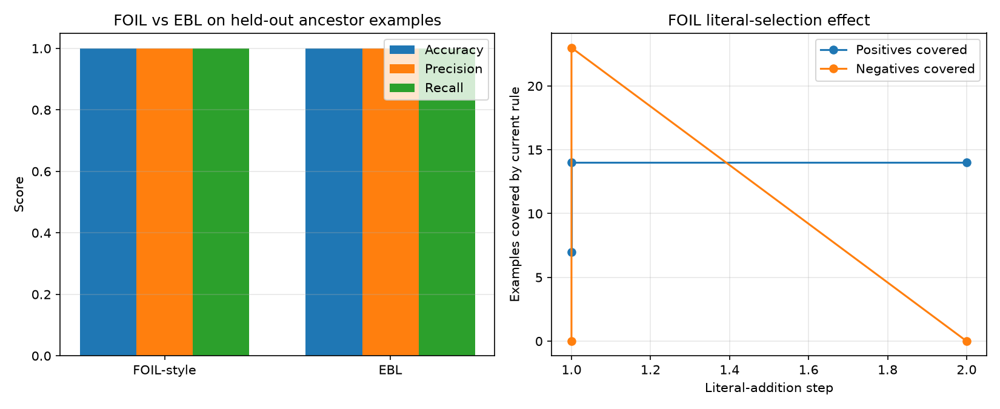

# ML Project — FOIL-style Relational Rule Learning and EBL

This project demonstrates **Relational Rule Learning** using a simplified **FOIL-style** algorithm and **Explanation-Based Learning (EBL)** on a synthetic family-relationship dataset. The target relation is `ancestor(X, Y)` learned/explained from `parent(X, Y)` background facts.

## Contents

| File | Description |
|---|---|
| `group4_foil_ebl.py` | Complete Python implementation (data, FOIL learner, EBL, evaluation, visualization) |
| `Group4_FOIL_EBL_Report.md` | Laboratory report (aim, theory, algorithm, results, discussion, comparison, limitations, conclusion) |
| `group4_foil_ebl_results.png` | Output visualization (metrics comparison + FOIL literal-selection trace) |
| `.gitignore` | Ignores Python cache/checkpoint artifacts |

## What the Program Does

1. Builds a synthetic relational dataset of `parent` facts and derives positive/negative `ancestor` examples.
2. Runs a **FOIL-style learner** that adds literals incrementally (e.g., `parent(X,Y)`, `parent(X,Z), ancestor(Z,Y)`) to separate positive and negative examples, printing intermediate trace steps.
3. Runs **EBL** using domain theory to explain a training example (`ancestor(Tom,Alice)`) and generalize a reusable rule.
4. Evaluates both approaches on held-out examples and computes accuracy, precision, recall, and F1 from actual predictions.
5. Saves a comparison visualization.

## Requirements

- Python 3.9+ (works in Google Colab / Jupyter Notebook)
- `pandas`
- `matplotlib`

Install dependencies if needed:

```bash
pip install pandas matplotlib
```

## Run

```bash
python group4_foil_ebl.py
```

The script prints facts, examples, FOIL literal-selection steps, learned rules, EBL explanation trace, predictions, metrics, and the comparison table. It also saves `group4_foil_ebl_results.png`.

## Output Visualization



The left chart compares FOIL-style and EBL accuracy/precision/recall on held-out ancestor examples. The right chart shows how FOIL literal additions affect positives/negatives covered by the current rule.

## Key Concepts Demonstrated

- **FOIL-style learning:** data-driven relational rule induction; uses examples and negative examples to select discriminating literals.
- **EBL:** knowledge-driven learning; uses domain theory to explain an example and generalize the explanation.
- **Comparison:** FOIL is useful when rules must be learned from data; EBL is efficient when correct domain theory is available.
